<div align="center">

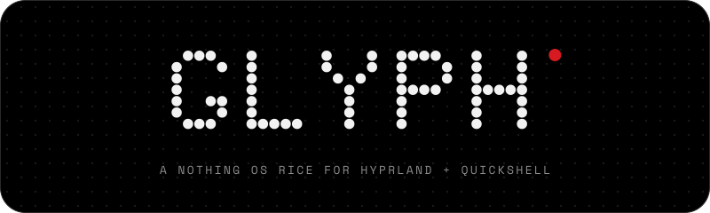

Black, white dots, one red. A sibling of [Demon's Shot](https://github.com/Nebelung-cloud/demons-shot-rice).

This is an adapted copy (fork) of [glyph-rice](https://github.com/Nebelung-cloud/glyph-rice), GPL-3.0. The upstream author's voice is kept in the sections below; the installer, uninstaller and this guide were adapted here.

<br>

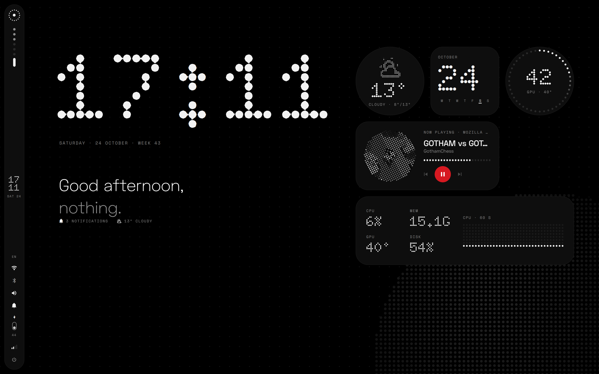

</div>

<div align="center">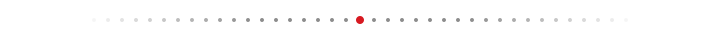</div>

<h2 align="center">What's inside</h2>

| | | |
|---|---|:---:|
| **Bar** | launcher, workspaces, clock, tray | |
| **Home** | clock, greeting, widgets (cava as a round Glyph Matrix), dot grid | |
| **Glyph** | screen edges as OSD: volume, brightness, notifications, progress | |
| **Launcher** | apps, style, tray, calculator | `Super` |
| **Quick** | quick settings, game mode, media, notifications; also opens from the right edge | `Super` `A` |
| **Deck** | dashboard from the bottom edge | `Super` `Space` |
| **Prefs** | settings, bar and home layout, audio devices | `Super` `I` |
| **Shot** | screenshots, editor, recording | `Print` |
| **Clip** | clipboard history | `Super` `V` |
| **Charms** | emoji, kaomoji, symbols | `Super` `.` |
| **Walls** | wallpapers as dots | `Super` `Shift` `W` |
| **VPN** | Clash Verge panel | `Super` `P` |
| **Cal** | calendar, focus timer | click the clock |
| **Buds** | Nothing / CMF earbuds and headphones: battery, model-specific ANC | |
| **Power** | power menu | `Super` `Esc` |
| **Lock** | lock screen | `Super` `L` |
| **Login** | SDDM theme: sessions on a camera dial, a Glyph tachometer that fills as you type, a staged power-on | `←` `→` |
| **Style** | where the colour comes from, like caelestia: Nothing (black, white, red), the wallpaper (one of its tones through a Material You variant — monochrome, neutral, tonal spot, rainbow, content, fidelity, fruit salad, expressive, vibrant) or a palette — Catppuccin, Rosé Pine, Gruvbox, Nord, Dracula, Tokyo Night, Everforest, Kanagawa. Shell, Hyprland and kitty follow at once, GTK and Qt apps when they next start | launcher → style, Prefs → Style (a live mock-up of the desktop shows the palette under the cursor before you pick it) |
| **Rice** | shell switcher, if Demon's Shot is installed too | `rice switch <name>` |

Also: Hyprland (Lua), hypridle, kitty, fish, starship, fastfetch, btop, cava (dots in fish; `command cava` for bars), GTK, Qt and folder colours.

<div align="center">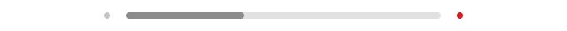</div>

<h2 align="center">Screenshots</h2>

| | |
|:---:|:---:|
| 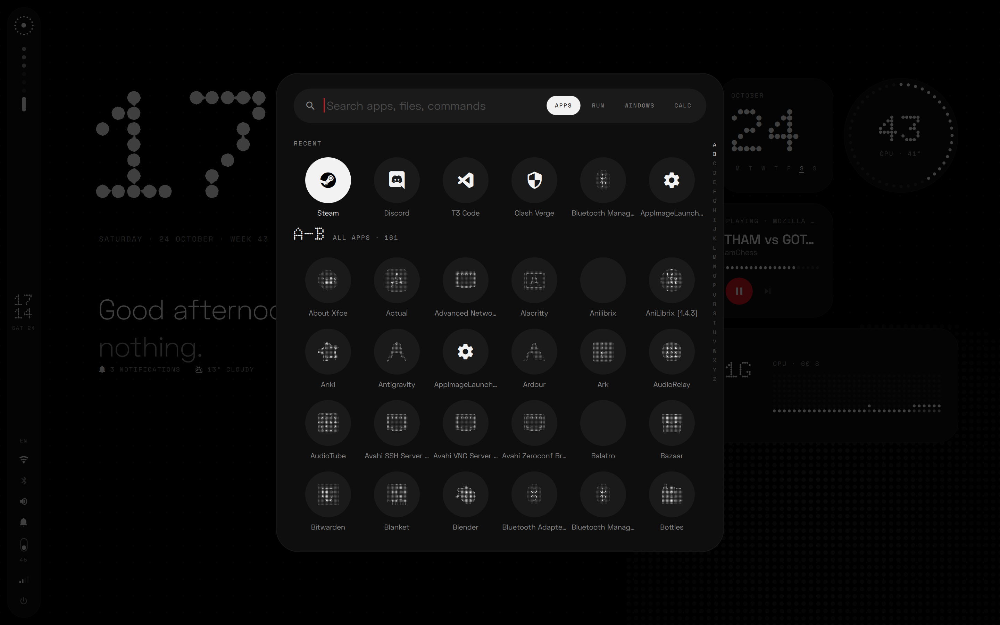 **Launcher** | 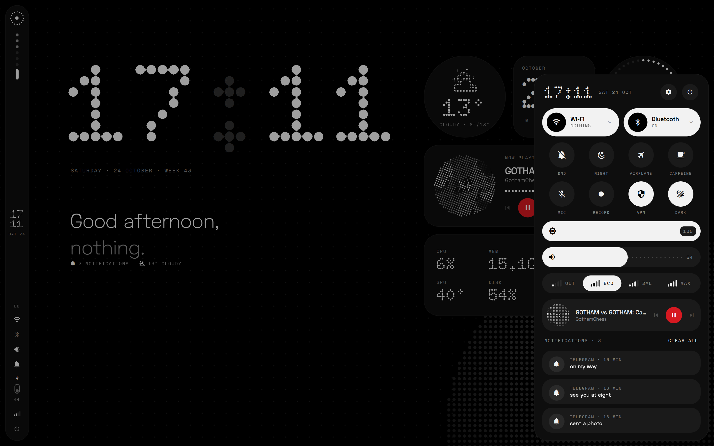 **Quick** |
| 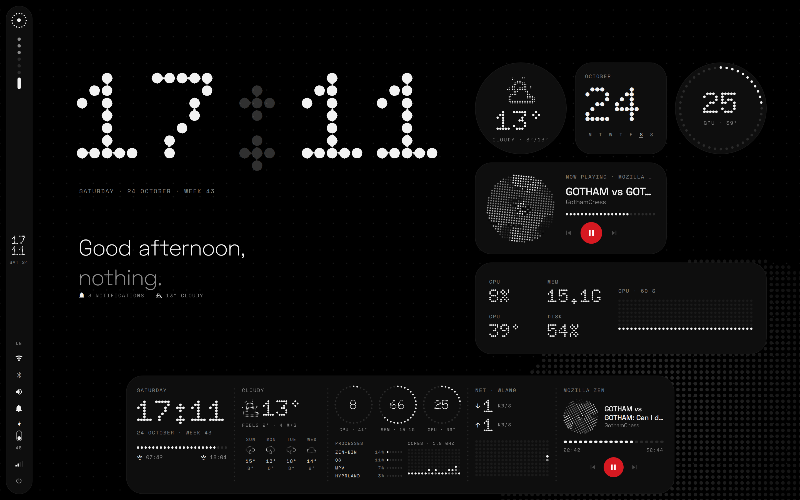 **Deck** | 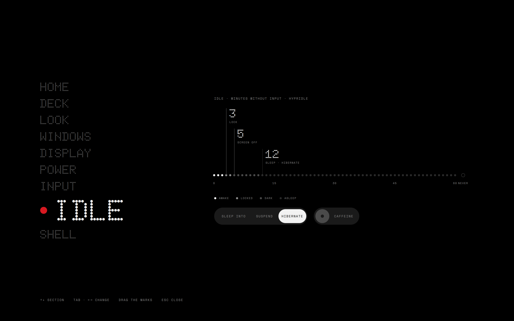 **Prefs** |
| 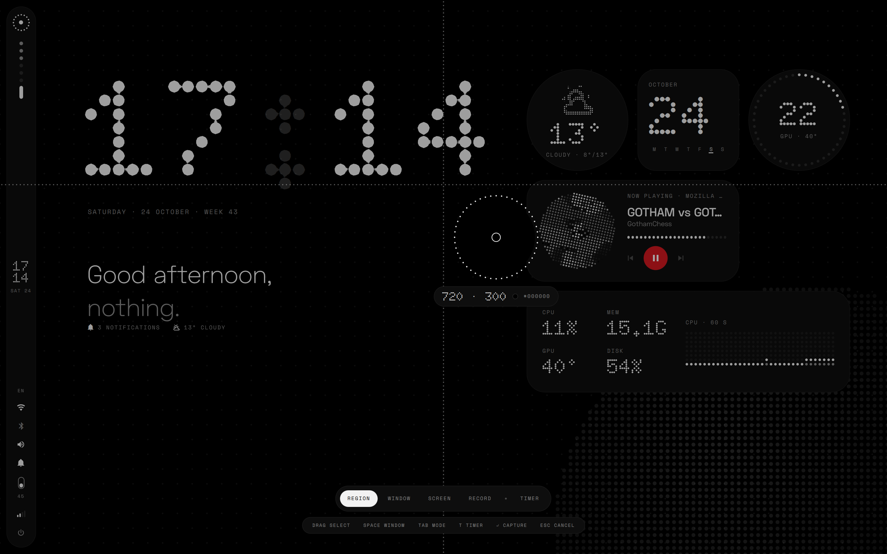 **Shot** | 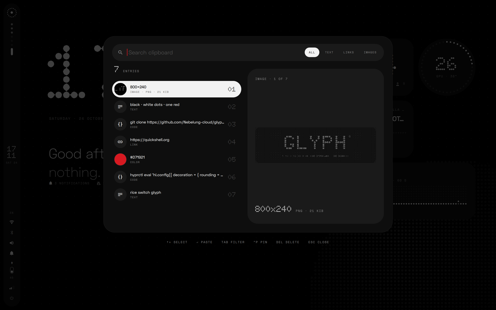 **Clip** |
| 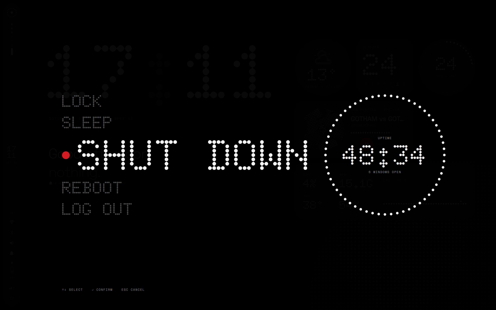 **Power** | 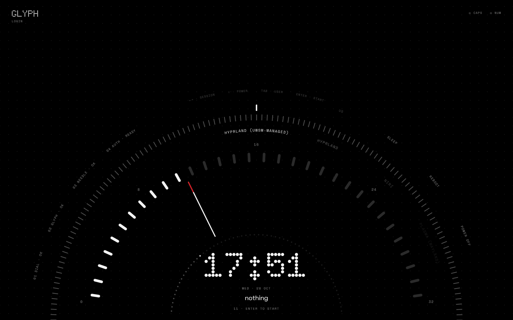 **Login** |

<div align="center">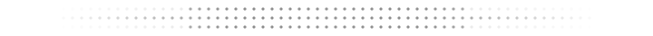</div>

<h2 align="center">Install</h2>

```sh
git clone https://github.com/RaidenMGR47/Nothing-OS-Arch-Linux-Ricing.git ~/.local/share/raidenmgr47
~/.local/share/raidenmgr47/install.sh                  # Arch: packages, services, symlinks, keyboard, login theme
~/.local/share/raidenmgr47/install.sh --check          # detect keyboard/monitors and print versions; change nothing
~/.local/share/raidenmgr47/install.sh --with telegram  # same, extras picked up front
~/.local/share/raidenmgr47/install.sh --links          # any distro: symlinks + keyboard override, no packages
~/.local/share/raidenmgr47/install.sh --sddm           # login theme only (sudo); run again after editing it
~/.local/share/raidenmgr47/uninstall.sh                # remove the symlinks, restore the newest backup
```

> If you downloaded a ZIP instead of cloning, GitHub names the folder `Nothing-OS-Arch-Linux-Ricing-main` — the name does not matter. Copy its contents to `~/.local/share/raidenmgr47` and run `chmod +x install.sh uninstall.sh` once before running them.

> 📖 **Guía completa en español:** [Arch Linux Installation.md](<Arch Linux Installation.md>) — instalación desde cero (BIOS/UEFI), chroot, GRUB, controladores de GPU, teclado y la nota del monitor BenQ.

Without `--with` it asks which extras to add: `telegram` (`Super` `D`), `spotify` with Spicetify (`Super` `M`),
`clash` for the VPN panel. AUR packages are installed interactively (unless `--yes`) so you can review the PKGBUILDs;
if you pick `spotify`, launch it and log in once, then run `spicetify config custom_apps marketplace && spicetify backup apply`.
Old configs go to `~/.dots-backup-<date>/`. Wallpapers are read from `~/Pictures/Wallpapers`,
gifs for the home cat tile from `~/Pictures/Gifs` (pick one in prefs → home, or click the tile; none there — the cat).
Weather (home, deck, lock) comes from open-meteo; the place is looked up by your IP at ipinfo.io unless
`DEMONSHOT_LATLON` is set, e.g. `hl.env("DEMONSHOT_LATLON", "52.52,13.40")` in `user.lua`.

| `config/` | goes to |
|---|---|
| `hypr/` | `~/.config/hypr` |
| `quickshell/glyph/` | `~/.config/quickshell/glyph` |
| `quickshell/rice/` | `~/.config/quickshell/rice`, `~/.local/bin/rice` |
| `quickshell/glyph/term/` | `starship.toml` `fastfetch/` `btop/` `cava/` `gtk-*/gtk.css` `qtengine.colors` in `~/.config` (with a Style colour — copies in `~/.local/state/rice/glyph`; edit `term/`) |
| `kitty/` `qtengine/` | `~/.config/…` |
| `fish/` | `~/.config/fish` |
| `fonts/` | `~/.local/share/fonts/glyph` |
| `sddm/glyph/` | copied to `/usr/share/sddm/themes/glyph` (the `sddm` user can't read your home), set in `/etc/sddm.conf.d/zz-glyph.conf`; `uninstall.sh` removes both |

The installer detects the keyboard instead of shipping one: it tries an existing `hypr/user.lua`, a live
Hyprland session, `XKB_DEFAULT_LAYOUT`, `localectl`, `/etc/X11/xorg.conf.d/00-keyboard.conf`,
`/etc/vconsole.conf`, `setxkbmap`, `/etc/default/keyboard` and the locale, in that order. The result goes
into `hypr/user.lua`; the console and X11 keymaps are updated too, so SDDM and the TTYs match. Force it
with `--keyboard latam`, `--keyboard "latam,us"` and `--kb-options grp:alt_shift_toggle`;
`--no-system-keyboard` leaves `/etc` untouched.

Monitors are read from `/sys/class/drm` and printed with their preferred mode. A connected output with
no modes usually means EDID/DDC failed (common with DVI→VGA adapters). Force the mode with
`--monitor DVI-I-1:1366x768@60`, optionally `OUTPUT:MODE:XxY:SCALE`; repeat it for several outputs.
It writes an `hl.monitor()` block in `user.lua`.

`hypr/user.lua` is gitignored: `git pull` never touches it. A fresh install creates it from
`hypr/user.lua.example` (with alternative binds that avoid the backslash key on `latam`), and a reinstall
keeps your previous file from the backup, rewriting only the managed `-- >>> glyph:...` blocks.

`uninstall.sh` reverses a full or `--links` install: it removes only symlinks that point into this repo,
restores the newest `~/.dots-backup-*`, and deletes the SDDM theme and the ydotool udev rule. Packages
and the repo stay; `--packages` offers to remove the optional AUR ones and `--dry-run` previews everything.

Backlight, GPU and sensors are detected. Default apps are in `hypr/variables.lua`. For an optional Buds image, add `<device-name>.png` to `quickshell/glyph/buds/`:
lowercase, with punctuation and spaces replaced by a single hyphen (e.g. `Nothing Ear (3)` → `nothing-ear-3.png`).
Glyph tries your Bluetooth alias first, then the hardware name, then shows a headphones icon.
Apps for the special workspaces and the editor are read when you press the key, so `user.lua` can swap them:

```lua
local apps = require("variables").apps
apps.editor = "codium"              -- Super Shift K, empty by default
apps.todo   = "planify"             -- Super R, empty by default
apps.music  = "spicetify watch -s"  -- Super M, spotify-launcher by default

hl.bind("SUPER + G", hl.dsp.global("shell:game"))  -- game mode has no key by default
```

<h2 align="center">Cambios en esta copia / What's different here</h2>

Respecto al rice original de [`Nebelung-cloud/glyph-rice`](https://github.com/Nebelung-cloud/glyph-rice), esta versión añade:

- **`install.sh` modular** (`lib/common.sh`, `lib/manifest.sh`, `lib/keyboard.sh`, `lib/monitor.sh`): detecta el teclado automáticamente y lo escribe en `hypr/user.lua`, mantiene consola/X11 sincronizados y detecta los monitores desde `/sys/class/drm`. Opciones nuevas: `--check`, `--keyboard`, `--kb-options`, `--no-system-keyboard`, `--monitor`, `--keep-dm`, `--no-aur` e `--yes`.
- **`uninstall.sh` nuevo**: quita solo los enlaces que apuntan a este repo, restaura `~/.dots-backup-*`, vuelve a poner `/etc/vconsole.conf` y `00-keyboard.conf` desde sus copias `.glyph-backup-*`, y elimina el tema de SDDM y la regla udev de `ydotool`. No desinstala paquetes salvo `--packages`.
- **`config/hypr/user.lua.example`**: atajos alternativos (`Super+Alt+C`, `Super+Alt+X`, `Super+Alt+P`) para teclados donde la barra invertida requiere `AltGr`. `user.lua` ya no se distribuye: se genera solo, con bloques gestionados `-- >>> glyph:...` que el instalador puede reescribir sin borrar lo tuyo.
- **Guía adaptada**: [Arch Linux Installation.md](<Arch Linux Installation.md>) documenta la Opción D con Glyph, `latam`, el monitor BenQ y el desinstalador.

Flujo recomendado para esta copia:

```sh
git clone https://github.com/RaidenMGR47/Nothing-OS-Arch-Linux-Ricing.git ~/.local/share/raidenmgr47
cd ~/.local/share/raidenmgr47
./install.sh --check                                   # detecta y muestra, sin cambiar nada
./install.sh --keyboard latam --monitor DVI-I-1:1366x768@60
sudo reboot
```

Para deshacer:

```sh
cd ~/.local/share/raidenmgr47
./uninstall.sh --dry-run
./uninstall.sh
```

<div align="center"></div>

<h2 align="center">Dependencies</h2>

| | |
|---|---|
| **Shell** | `quickshell` 0.3.1+ (Qt 6.9+) · `hyprland` 0.56+ · `hypridle` · `hyprsunset` · `xdg-desktop-portal-hyprland` · `jq` · `curl` · `python3` · `libqalculate` |
| **System** | `sddm` 0.21+ (Qt 6 greeter) · `networkmanager` · `bluez` · `blueman` (Bluetooth pairing agent) · `pipewire` · `pipewire-pulse` · `pipewire-alsa` · `wireplumber` · `upower` · `power-profiles-daemon` · `brightnessctl` · `libnotify` · `playerctl` · `polkit-gnome` · `gnome-keyring` · `geoclue` |
| **Capture** | `grim` · `slurp` · `imagemagick` · `libvips` · `gpu-screen-recorder` · `cliphist` · `wl-clipboard` |
| **Terminal** | `kitty` · `fish` · `starship` · `fastfetch` · `btop` · `cava` · `eza` · `zoxide` · `direnv` |
| **Look** | `papirus-icon-theme` · `adw-gtk-theme` · JetBrains Mono Nerd Font · `noto-fonts-emoji` (Emoji 17) · `noto-fonts-cjk` · Bibata · `qtengine` · `darkly` |
| **Optional** | `clash-verge-rev` · `nvidia-utils` · `ydotool` · `hyprpicker` · `swappy` · `trash-cli` |

From the AUR only `qtengine`, `darkly`, Bibata and Zen, plus Spicetify and Clash Verge if picked; all optional. The VPN panel expects Clash Verge in English.
NixOS: change the `/usr/lib` agent paths in `hypr/hyprland/execs.lua` and the Papirus path in `quickshell/rice/rice`.

<div align="center"></div>

<h2 align="center">Colours</h2>

<div align="center">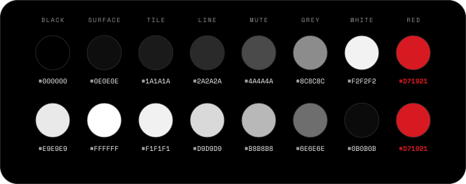</div>

<br>

Dark and light. Red marks the one live thing on screen.
Fonts: Doto, Space Grotesk, Space Mono, JetBrains Mono Nerd Font.

<div align="center"></div>

<h2 align="center">Inspiration</h2>

- [**Nothing OS**](https://nothing.tech): the look and the Glyph lights.
- [**Doto**](https://github.com/oliverlalan/Doto): the dot matrix font.
- [**Gadgetbridge**](https://codeberg.org/Freeyourgadget/Gadgetbridge): the earbuds protocol in `glyph/ear`.
- [**Caelestia**](https://github.com/caelestia-dots/shell): the shell I used before; the deck and hardware detection follow it.

<div align="center"></div>

<h2 align="center">License</h2>

[GPL-3.0](LICENSE). Fonts are under the [OFL](config/fonts/OFL.txt), cava shaders keep their MIT headers.
Nothing, Nothing OS and Glyph are trademarks of Nothing Technology Ltd; this is a fan project, not affiliated with Nothing.

<div align="center"></div>

<div align="center">

```
ᓚᘏᗢ  · · ·
```

```
⠀⠀⠀⠀⣰⣶⣦⣄⡀⠀⠀⠀⠀⠀⠀⠀⠀⠀⠀⠀⠀⠀⠀⢀⣤⣶⣶⡆⠀⠀⠀⠀
⠀⠀⠀⢠⣿⣿⣿⣿⣿⣦⡀⠀⠀⠀⠀⠀⠀⠀⠀⠀⠀⣠⣶⣿⣿⣿⣿⣿⠀⠀⠀⠀
⠀⠀⠀⢸⣿⣿⣿⣿⣿⣿⣿⣦⡀⠀⠀⠀⠀⠀⠀⢀⣾⣿⣿⣿⣿⣿⣿⣿⡆⠀⠀⠀
⠀⠀⠀⢸⣿⣿⣿⣿⣿⣿⣿⣿⣿⣄⣀⣀⣀⣀⣰⣿⣿⣿⣿⣿⣿⣿⣿⣿⡇⠀⠀⠀
⠀⠀⠀⢸⣿⣿⣿⣿⣿⣿⣿⣿⣿⣿⣿⣿⣿⣿⣿⣿⣿⣿⣿⣿⣿⣿⣿⣿⡇⠀⠀⠀
⠀⠀⠀⠸⣿⣿⣿⣿⣿⣿⣿⣿⣿⣿⣿⣿⣿⣿⣿⣿⣿⣿⣿⣿⣿⣿⣿⣿⠁⠀⠀⠀
⠀⠀⠀⠀⢿⣿⣿⣿⣿⣿⡿⢿⣿⣿⣿⣿⣿⣿⣿⣿⠿⣿⣿⣿⣿⣿⣿⡏⠀⠀⠀⠀
⠀⠀⠀⠀⣼⣿⣿⣿⣿⡏⠀⠀⢹⣿⣿⣿⣿⣿⣿⠃⠀⠀⣿⣿⣿⣿⣿⣆⠀⠀⠀⠀
⠀⠀⠀⣸⣿⣿⣿⣿⣿⣷⣀⣀⣼⣿⣿⣿⣿⣿⣿⣦⣀⣠⣿⣿⣿⣿⣿⣿⡆⠀⠀⠀
⣀⣠⣤⣿⣿⣿⣿⣿⣿⣿⣿⣿⣿⣿⣿⣿⣿⣿⣿⣿⣿⣿⣿⣿⣿⣿⣿⣿⣷⣤⣀⡀
⠻⠿⠛⣿⣿⣿⣿⣿⣿⣿⢿⣿⣿⣿⣷⠀⢀⣿⣿⣿⣿⣿⣿⣿⣿⣿⣿⣿⡟⠛⠿⠇
⠀⢀⣠⣾⣿⣿⣿⣿⣿⣿⡈⢿⣿⣿⣿⠃⠸⣿⣿⣿⡿⢰⣿⣿⣿⣿⣿⣿⣷⣄⠀⠀
⠀⢿⠿⠋⢻⣿⣿⣿⣿⣿⣷⣄⣉⣉⣡⣾⣧⣈⣉⣉⣴⣿⣿⣿⣿⣿⣿⠏⠙⢿⡗⠀
⠀⠀⠀⠀⠀⠻⣿⣿⣿⣿⣿⣿⣿⣿⣿⣿⣿⣿⣿⣿⣿⣿⣿⣿⣿⣿⠏⠀⠀⠀⠀⠀
⠀⠀⠀⠀⠀⠀⠈⠻⣿⣿⣿⣿⣿⣿⣿⣿⣿⣿⣿⣿⣿⣿⣿⡿⠟⠁⠀⠀⠀⠀⠀⠀
⠀⠀⠀⠀⠀⠀⠀⠀⠀⠉⠛⠻⠿⢿⣿⣿⣿⣿⠿⠿⠟⠛⠉⠀⠀⠀⠀⠀⠀⠀⠀⠀
```

</div>
